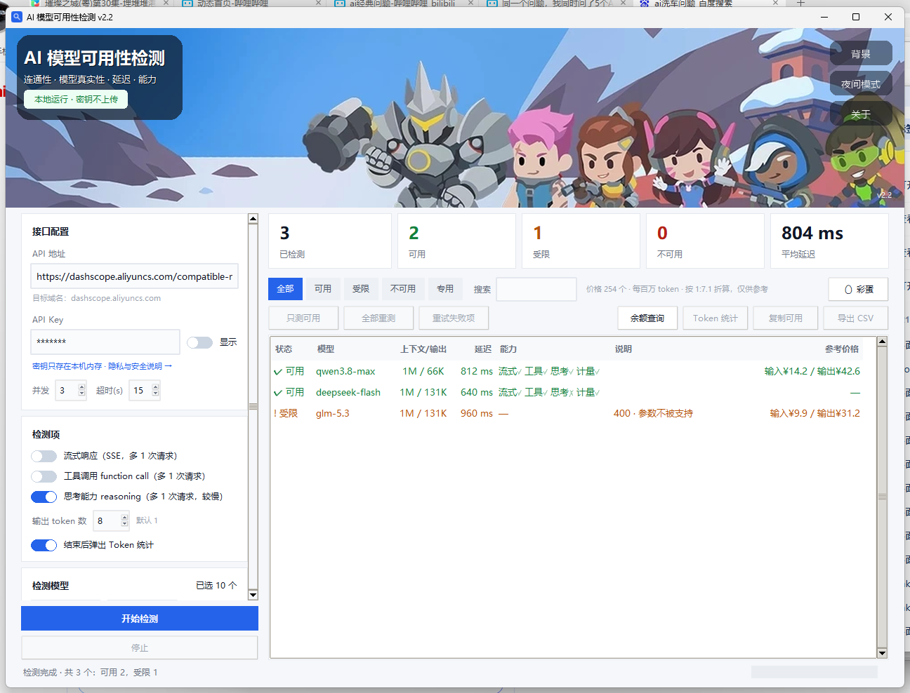
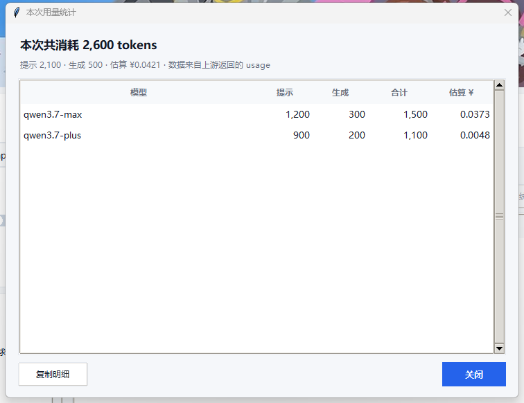
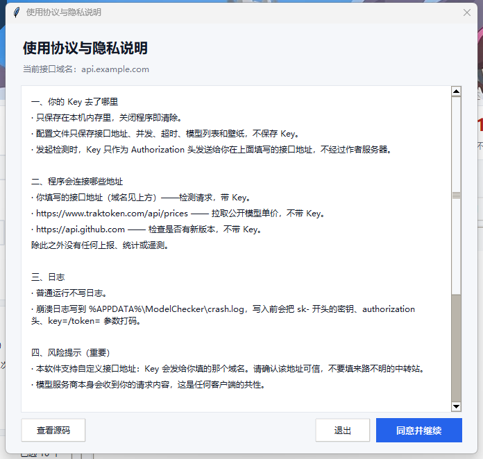

<p align="center">
  <a href="https://t.me/OiPeter"></a>
  <a href="https://github.com/peter8889/AI-Model-Availability-Checker/releases"></a>
  <a href="LICENSE"></a>
</p>

# AI 模型可用性检测

> 一个突发奇想且刚需的小工具 🧰 欢迎提出修改意见~

手上一堆 API Key，却不知道哪些模型真的能用、哪些是挂着名字的空壳、哪些参数一改就报错。**AI 模型可用性检测**就是为这件事写的：填一个 OpenAI 兼容的接口地址，一次性把所有模型的连通性、真实性、延迟、能力边界全部测出来，导出成能直接贴进表格的报告。

## 为什么不是「测通就算」

市面上多数检测器只区分「通」和「不通」。但真实世界里，`400` 往往意味着**模型是活的，只是不接受你传的参数**——把它判成不可用，会让你错过一个能用的模型。本工具的核心差异就在这套判定逻辑：

| 响应 | 判定 | 意味着什么 |
| --- | --- | --- |
| `200` | **可用** | 模型存在且正常响应 |
| `400` 参数不兼容 | **可用（受限）** | 模型是活的，只是不吃某些参数 |
| `401` | **Key 失效** | 全局中止，避免无谓消耗 |
| `403` / `404` / `402` | 无权限 / 不存在 / 余额不足 | 逐项区分，不混为一谈 |
| `429` / `5xx` | **重试后判定** | 限流与临时故障不等于不可用 |

一条 `400 · 参数不被支持` 被正确识别为「可用（受限）」，这就是它和粗粒度检测器的分水岭。

## 界面

<p align="center"></p>

<table>
<tr>
<td width="50%"></td>
<td width="50%"></td>
</tr>
<tr>
<td width="50%"></td>
<td width="50%"></td>
</tr>
</table>

## 功能

**连通性与真实性**
- `GET /models` 拉全量清单，逐个实测，识别「列表里挂着但实际不存在」的幽灵模型
- 延迟统计（单项 + 平均值），支持并发（1–32）
- 中文失败原因归类，不用再去猜 `403` 和 `402` 的区别

**能力探测**
- 流式响应（SSE）、工具调用（function call）、`usage` 计量
- **思考能力**：按厂商自动选择参数形态（`reasoning_effort` / `thinking_budget` / `thinking.type`），失败自动回退，从 `reasoning_content`、`reasoning_tokens` 等字段判定
- **上下文 / 最大输出**：按模型名匹配规格，表格直接显示 `1M / 66K`

**用量与成本**
- 本次消耗 token 统计，按单价折算金额（¥，参考值）
- **余额查询**：自动匹配 DeepSeek / Kimi / 硅基流动 / OpenRouter 等官方接口；中转站兜底 `/api/usage/token`；无公开接口的厂商明确告知，不假装成功

**工程细节**
- 停止立即生效（自建 daemon 线程池 + 队列，不用 `ThreadPoolExecutor` 的阻塞式 shutdown）
- 迟到结果双重过滤（`run_id` + `_live_rid`），停止后不会污染表格
- 列宽按内容自适应，窗口缩放不裁切
- 导出 CSV / JSON，一键复制可用清单
- 配置记忆（接口地址、并发、超时、壁纸），**不保存 API Key**

## 安装与使用

1. 从 [Releases](https://github.com/peter8889/AI-Model-Availability-Checker/releases) 下载 `ModelChecker-v2.2.exe`
2. 双击运行，首次启动会弹出使用协议
3. 填入接口地址（如 `https://dashscope.aliyuncs.com/compatible-mode/v1`）和 API Key
4. 点「选择模型」多选，或直接点「开始检测」跑全量
5. 结束后导出 CSV，或点「🥚 彩蛋」看个乐子

单文件免安装，无需 Python 环境。仅支持 Windows x64。

## 安全与隐私

设计原则：**不要求你相信宣传，而是让你能自己验证。**

- **API Key 只存在内存里**，关闭程序即清除；配置文件仅保存接口地址、并发、超时、壁纸等，不含 Key
- **只有三个出网目标**：
  - 你填写的接口地址（检测请求，带 Key）
  - `www.traktoken.com/api/prices`（公开单价，不带 Key）
  - `api.github.com`（检查更新，不带 Key）
- **无遥测、无上报、无统计**
- 崩溃日志写入 `%APPDATA%\ModelChecker\crash.log` 前会打码（`sk-***`、`authorization <masked>`、`key=/token= ***`）
- **风险提示**：本工具支持自定义接口地址，Key 会发给你填的那个域名。软件界面会实时显示「目标域名」，请确认可信——不要把 Key 发给来路不明的中转站

自行验证的方式：
- 源码完全公开，Key 的读取与发送集中在 `http_json()` 与 `start()`
- 用 Fiddler / Wireshark / mitmproxy 抓包，可确认只连上述三个域名（HTTPS 内容需装根证书解密）
- 校验发布包 SHA-256 与 Release 页面公布的一致

### 校验值

| 版本 | SHA-256 |
| --- | --- |
| v1.0 | `ad34ea6fa0257e315c0983870b08c081156cd622248d7a01615915291f77e0b4` |
| v2.1 | `6ef13886e78ba462721567d0cc94d22e05c162a67eef62d18bb5b18e775fa5f7` |
| v2.2 | `510f7e7948401e62ed48121d3dbd5a95c03db431dc44472e2e4ba902b82af1ce` |

## 从源码构建

```bash
pip install pillow pyinstaller
python -m PyInstaller --noconfirm --clean --onefile --windowed ^
  --name ModelChecker --icon app.ico --version-file version_info.txt ^
  --add-data "app.ico;." --add-data "bg.jpg;." --add-data "assets;assets" ^
  model_checker_gui.py
```

需要 Python 3.10+ 且带 tkinter。

命令行版可直接运行 `python check_models.py --help`。

## 版本历史

| 版本 | 主要内容 |
| --- | --- |
| [v2.2](https://github.com/peter8889/AI-Model-Availability-Checker/releases/tag/v2.2) | 思考能力探测（11 家厂商参数差异自适应）、上下文/输出规格列、用量金额估算、余额查询、洗车彩蛋 |
| [v2.1](https://github.com/peter8889/AI-Model-Availability-Checker/releases/tag/v2.1) | 中文失败原因、受限独立状态、延迟与能力列、暗夜模式、背景横幅、使用协议与隐私说明、Token 统计 |
| [v1.0](https://github.com/peter8889/AI-Model-Availability-Checker/releases/tag/v1.0) | 首个版本：模型清单拉取、并发探活、七类状态判定、CSV/JSON 导出、命令行与图形界面双版本 |

## 参与

Issue 和 PR 都欢迎。如果这个工具帮你省了时间，点个 ⭐ 就够。

## License

MIT. 详见 [LICENSE](LICENSE)。